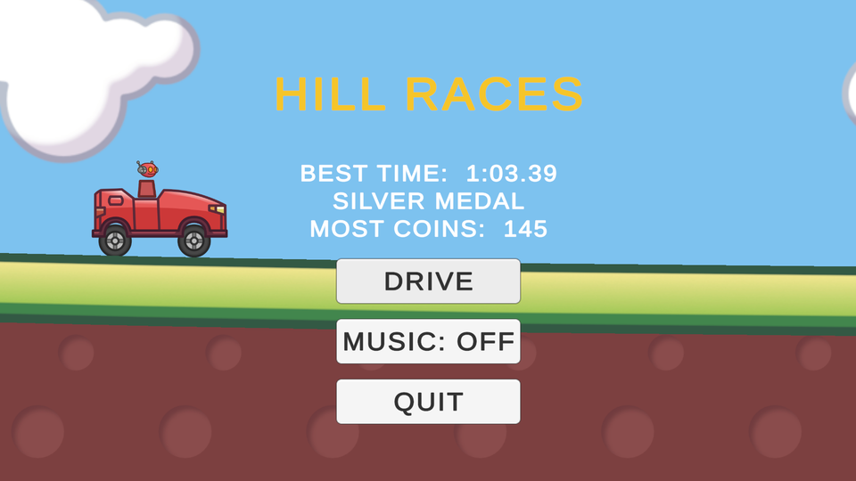
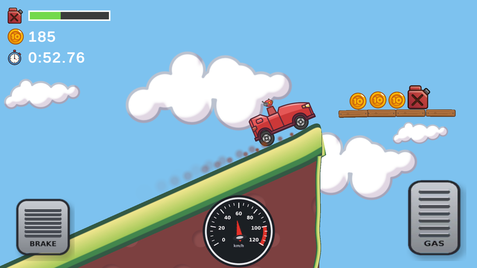
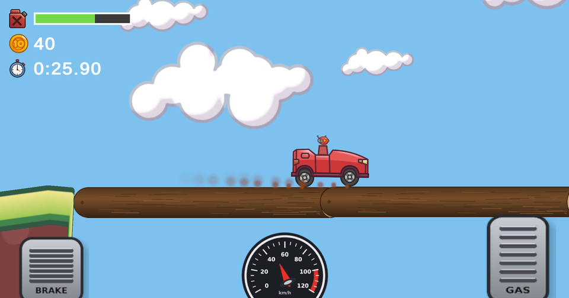
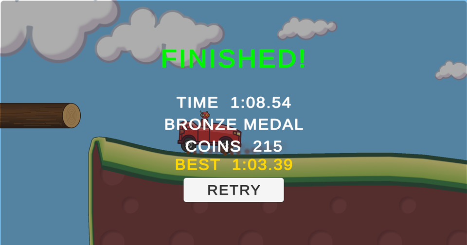

# Hill Races

A physics-driven hill racing game inspired by *Hill Climb Racing*, built solo in **Unity 6 (C#)** – from the game design document to the finished game.

Drive a buggy across a hand-built course to the finish line. Fuel is deliberately short, so the cans that keep you going sit off the safe line, and a clean flip in the air pays out a burst of nitro. Land on the driver's head and the buggy explodes. Your finish time earns a medal; coins are the score.

| | |
| --- | --- |
|  |  |
|  |  |

## Features

- **Real physics driving** – the buggy is a `Rigidbody2D` with two wheels on `WheelJoint2D` suspension. Nothing moves it by setting position or velocity; all motion comes from wheel motors and gravity.
- **One input, two meanings** – the same keys are throttle and brake on the ground and rotate the buggy in the air.
- **Flips and nitro** – rotation is tracked through the whole jump; a clean landing on both wheels is judged as a flip (`BACKFLIP!`, `DOUBLE FRONTFLIP!`) and rewarded with nitro.
- **Fuel pressure** – fuel drains constantly; when it runs out the engine cuts and the buggy coasts until it stops.
- **Crash and explosion** – fireball, smoke, camera shake, and the wheels torn off their joints.
- **Medals and records** – gold, silver or bronze by finish time; best time, best medal and most coins are saved between sessions.
- **Full HUD** – fuel bar with a low-fuel alarm, coin counter, timer, animated gas and brake pedals and a speedometer.
- **Audio** – engine pitch follows the wheel speed, tyre roll on gravel, music that plays on across scenes and can be turned off from the menu.

## Controls

| Action | Keyboard | Gamepad |
| --- | --- | --- |
| Gas (ground) / rotate nose up (air) | `D` / `→` | RT or A |
| Brake and reverse (ground) / rotate nose down (air) | `A` / `←` | LT or X |
| Restart course | `R` | Y |
| Pause | `Esc` / `P` | Start |

## Technical highlights

- **Smooth terrain from a few points** – the course is drawn as `EdgeCollider2D` points in the editor. At load, `CourseMeshBuilder` turns them into a Catmull-Rom curve, writes the curve back to the collider so physics matches the visuals, and builds the grass and dirt meshes with seamless tiling UVs.
- **Data-driven tuning** – all gameplay numbers live in two ScriptableObjects: `VehicleConfig` (mass, centre of mass, suspension, motor, nitro) and `CourseConfig` (fuel budget, medal times). Tuning never needs a code change.
- **Event-driven architecture** – a per-scene `GameManager` owns the run state; the crash detector, flip tracker, UI and explosion communicate through events instead of direct references.
- **Object pooling** – a generic `PoolService<T>` reuses wheel dust, nitro flame, explosion particles and clouds.
- **Singletons with different lifetimes** – `GameManager` lives per scene, `AudioManager` persists across scenes so the music never restarts.
- **Coroutines** for timed sequences: the coast-out, the crash sequence, end-screen input lockout and popups.
- **Cinemachine 3** for the follow camera and the explosion shake; **Input System** for keyboard and gamepad; **PlayerPrefs** for saved records and settings.

The full design – game loop, tuning parameters, UI, art and audio plan and architecture – is in the [Game Design Document](Docs/GDD.md).

## Running

1. Open the project in **Unity 6000.3.20f1** (Unity Hub).
2. Open `Assets/Scenes/Menu.unity` and press Play.

## Credits

Vehicle, terrain and pickup art from the *Physics Car Game Asset Pack* by LucyLavend; sound and music sources are listed in [`Docs/CREDITS.md`](Docs/CREDITS.md).
